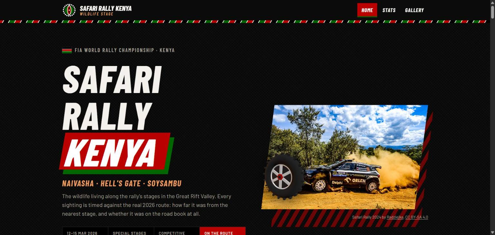
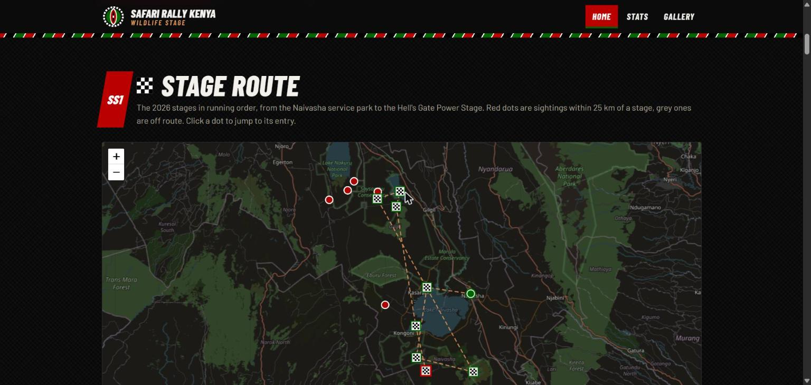
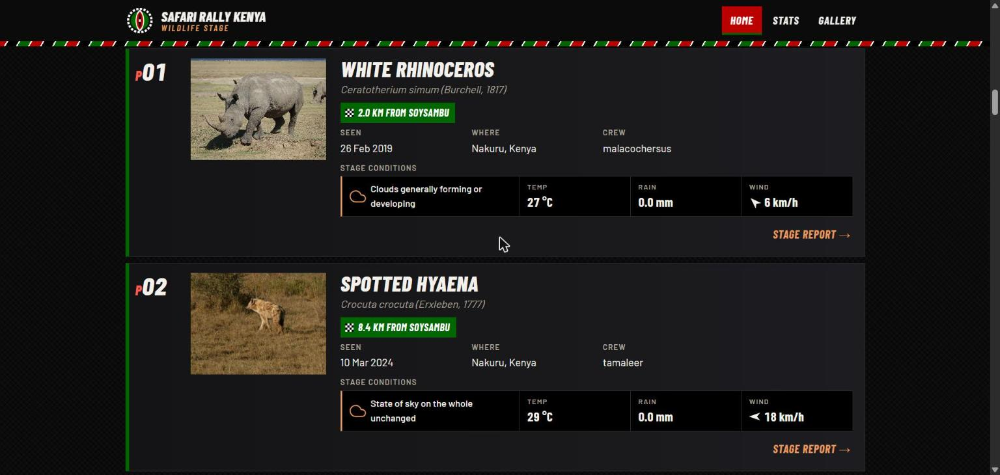
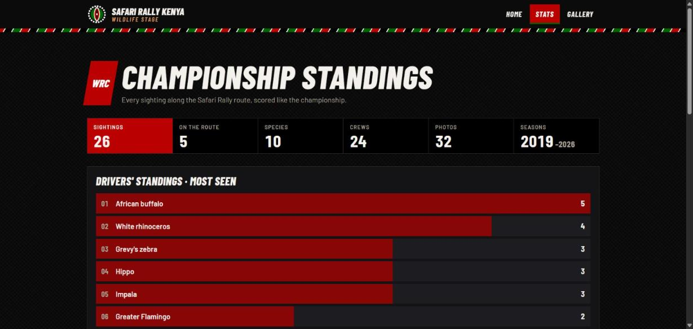
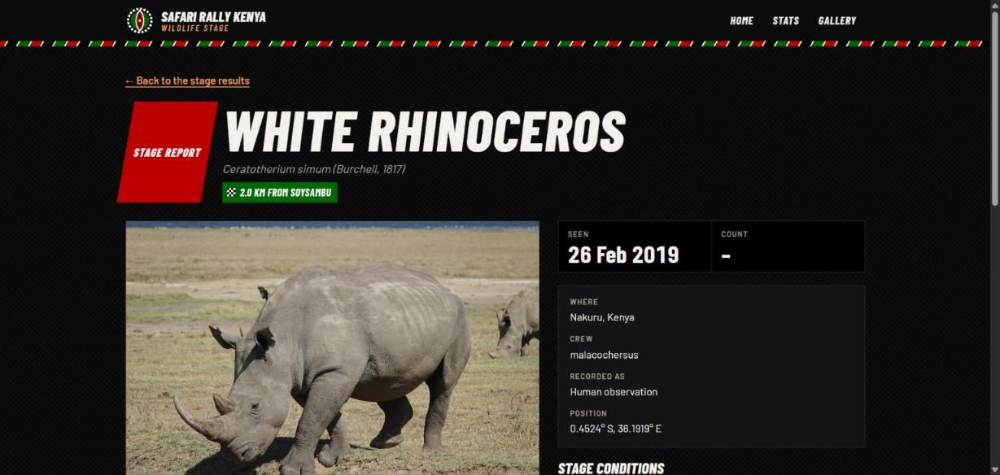

# Full-Stack Go: Domain-Driven Applications with sqlc and templ

**About the author:**
Ainsley Clark, Go Developer Advocate @ JetBrains

- https://ainsleyclark.com/
- https://github.com/ainsleyclark
- https://www.linkedin.com/in/ainsleyclark/
- https://x.com/ainsleydev/

**GopherCon Africa 2026, Nairobi**

The workshop app: a site for **animal sightings**. Occurrence records come from
[GBIF](https://www.gbif.org), are stored in SQLite through [sqlc](https://sqlc.dev), rendered
server-side with [templ](https://templ.guide), and enriched with
[Open-Meteo](https://open-meteo.com) weather.

This repository is yours for the day. It's the finished app, we walk through it together, then
you make the site your own in your fork and push it there.

## My site: Safari Rally Kenya · Wildlife stage

The sightings site, rebuilt as a WRC broadcast for the **Safari Rally Kenya**, the World Rally
Championship round run from Naivasha every March. The Kenyan flag meets a stage timing screen.



**The idea: every sighting is timed against the real 2026 route.** The nine stage areas of the
2026 rally (Naivasha service park, Loldia, KenGen Geothermal, Kedong, Soysambu, Elmenteita,
Sleeping Warrior, Oserengoni and the Hell's Gate Power Stage) are mapped in running order. Each
sighting is measured to its nearest stage with the haversine formula. Sightings within 25 km are
ranked as results (P01, P02…) and the rest are marked **OFF** route.



| Page | What's on it |
|------|--------------|
| `/` | Banner with a three.js rally wheel, the stage route map, stage results ranked by distance (filter by stage, animal or year), standings, and Safari Rally photos |
| `/sightings/{id}` | A **stage report**: big photo, distance to the nearest stage, crew, road-book position, full stage conditions (weather) and a map of the spot among the stages |
| `/stats` | **Championship standings**: a timing board of totals, the most-seen animals, the busiest stages, results by year and the top crews |
| `/gallery` | A photo wall of every sighting's photos, each credited to its photographer, with its licence |
| anything else | A 404: "Off the road, wrong stage" |



<p>
  
  
</p>

### How it's built

- **Go and templ only, no JavaScript build.** Pages are templ components in `web/views/`, handlers
  in `web/handlers/`, and every route is in `web.New`. The home, stats and gallery pages share one
  `routeFilter()` (Kenya, and the animals of the Rift Valley stages) and one `routePage` helper.
- **The route maths** lives in `web/views/components/rally.go`: the stages, `NearestStage`,
  `OnRoute`, `ByDistance` and `StageTally`. It's tested in `rally_test.go`.
- **Handlers are tested** in `web/handlers/`: a stage report that exists, a bad id and a missing
  sighting (both 404), a store failure (500), and stats and gallery with and without data.
- **Each page loads only what it uses.** Leaflet loads on pages with a map, three.js only on the
  home page, and the filter script only where there are filter chips.
- **Kind to phones and people.** It's checked at 390 px wide with no sideways scroll. Motion stops
  for people who turn it off, the 3D wheel pauses off screen, and labels, alt text and focus
  outlines are throughout.
- **The design** is written down in [`web/DESIGN.md`](web/DESIGN.md): colours, lettering, components
  and rules.

```bash
make web          # http://localhost:8080
go test ./web/... # handler and route tests
```

### Credits

Wildlife records from [GBIF](https://www.gbif.org), weather from [Open-Meteo](https://open-meteo.com),
maps © [OpenStreetMap](https://www.openstreetmap.org/copyright) contributors. Rally photos from
Wikimedia Commons: [Radziejka](https://commons.wikimedia.org/wiki/File:Kajetan_Kajetanowicz_Rajd_Safari2024.jpg)
(CC BY-SA 4.0), [Joelm69](https://commons.wikimedia.org/wiki/File:WRC_Safari_Rally_2021_(cropped_2).jpg)
(CC BY-SA 4.0), [Jared-G-Maina](https://commons.wikimedia.org/wiki/File:Kenya_KCB_Rally_Naivasha_4.jpg)
(CC BY-SA 4.0) and [TTTNIS](https://commons.wikimedia.org/wiki/File:2021_Toyota_Yaris_WRC_Katsuta.jpg)
(CC0). Stage positions are the centre of each stage's area, not its exact roads. A fan site,
not affiliated with the WRC, the FIA or the Safari Rally Kenya organisers.

## Before you start

You need Go (the version in `go.mod`), Git, `make` and a GitHub account. For the Theming block
you'll also want [Claude Code](https://code.claude.com/docs/en/setup) and Python 3. GoLand is
the preferred IDE for this workshop, and you should have had a voucher for it by email (see
[GoLand and your voucher](#goland-and-your-voucher)).

|             | macOS                                        | Linux                                   | Windows                                  |
|-------------|----------------------------------------------|-----------------------------------------|------------------------------------------|
| GoLand      | the [Toolbox App](https://www.jetbrains.com/toolbox-app/) or https://www.jetbrains.com/go/download | the same | the same |
| Go          | `brew install go`                            | `sudo snap install go --classic`        | the `.msi` from https://go.dev/dl        |
| Git         | comes with `make` below                      | `sudo apt install git`                  | `winget install Git.Git`                 |
| `make`      | `xcode-select --install`                     | `sudo apt install make`                 | `winget install ezwinports.make`         |
| Claude Code | `curl -fsSL https://claude.ai/install.sh \| bash` | the same                           | `irm https://claude.ai/install.ps1 \| iex` |
| Python 3    | `brew install python`                        | `sudo apt install python3`              | `winget install Python.Python.3.12`      |


### Prerequisites

- Go 1.27.1 or newer on the device you bring, with ~/go/bin on your PATH.
- A GitHub account.

### GoLand and your voucher

The voucher gives you GoLand free for three months. You don't have to use GoLand, but the
walkthrough and the demos are in it.

1. **Create a JetBrains Account** at https://account.jetbrains.com, if you haven't one already.
2. **Redeem the code** from your email at https://www.jetbrains.com/store/redeem/, signed in to
   that account.
3. **Install GoLand** and open it. When it asks for a licence, choose *Log in to JetBrains 
   Account* and sign in with the same account, so it picks the licence up.

### Plugins and agents

In GoLand, open *Settings* → *Plugins* → *Marketplace* and install:

- **[templ](https://plugins.jetbrains.com/plugin/23088-templ)**: highlighting and navigation 
  for `.templ` files.
- **[Air](https://plugins.jetbrains.com/plugin/33314-air)**: JetBrains' agent window.

### Slack

Join the workshop's Slack channel; it's the quickest way to ask for help. There are a lot of you, so
answer each other's questions too.

## Where things are

```
main.go                     thin; hands off to internal/cmd
migrations/                 goose migrations
queries/                    sqlc queries, a file per table
internal/
├── cmd/                    CLI commands and the interactive menu
├── domain/                 the rules: sighting, species, weather — and their stores
├── clients/                outbound adapters: gbif, openmeteo
├── infra/                  config, sqlite, sqlc output
└── common/                 small generic helpers
web/                        your view layer: web.go owns the routes, handlers/, views/, assets/
architectures/              the opening tour, a ladder of five layouts; read, not typed in
.claude/, .junie/           Claude Code and Junie: settings and the /design-site skill for the Theming block
```

Each of `internal/{domain,clients,infra,common}` has a README saying where its line falls.
`SYLLABUS.md` is the course outline you were sent beforehand.

## Get set up

1. **Fork this repository** with the *Fork* button at the top of https://github.com/ainsleyclark/workshop-gophercon-africa-2026.
   Your fork is where you push all day.
2. **Clone your fork** and open the folder in your IDE:

   ```sh
   git clone git@github.com:<your-github-user>/workshop-gophercon-africa-2026.git
   cd workshop-gophercon-africa-2026
   ```

   No SSH key? Use `https://github.com/<your-github-user>/workshop-gophercon-africa-2026.git` instead.
3. **Run setup once.** It builds the tools from `vendor/` without downloading anything, and
   installs the app as `workshop` in `~/go/bin`. It takes a couple of minutes.

   ```sh
   make setup
   ```
4. **Seed the database and start the site**, then open http://localhost:8080:

   ```sh
   go run . db seed
   make web
   ```

## During the day

```sh
make run        # the interactive CLI: migrate, seed, ingest sightings, list, stats, web
make run-live   # the same, against the real GBIF and Open-Meteo instead of the mock
make web        # serve the site on :8080
make web-hot    # the same, with templ hot reload
make templ      # regenerate templ after editing a .templ file
make sqlc       # regenerate sqlc after editing a query or migration
make test       # the tests
make key        # save the workshop's Claude key, for Claude Code in a terminal
make load       # load test the home page for 20 seconds, while make web runs
make load-pprof # the same, saving CPU and memory profiles
make update     # pull the instructor's latest changes
make push       # commit everything and push it to your fork
make help       # everything else
```

- **More sightings:** `make run`, then `sightings` → `ingest`. It reads from a mock of GBIF and
  Open-Meteo bundled with the app, so it works offline and never hits a rate limit. `make run-live`
  uses the real APIs.
- **Database in a mess?** `git checkout workshop.db` puts back the copy you last committed.
- **Push to your fork as you go** with `make push`, `workshop.db` included, so the instructor can
  see what you've built. `/design-site` does this for you after each of Claude's turns.

**On Windows**, run these from PowerShell or Git Bash. Every recipe in the `Makefile` is a plain
`go` or `git` command, so if `make` won't cooperate, open `tools/setup.mk` and run the lines under
`tools:` and `setup:` yourself. If `vendor/` ever fails you, `make tools-online` installs the
same tools at the same versions from the internet.

## Theming your site

This part is yours; you design your own home page with an agent and the `/design-site` skill.
Think about the animals you like, the countries you'd show them in, and the colours and look you
want. Don't be afraid to add some flair, and use your imagination.

1. **Add the workshop's Claude key**, from Slack. In GoLand, press Ctrl twice to open Air, click
   the accounts button at the bottom right, choose *More providers* → *Anthropic* and paste the
   key. Not using GoLand? Run `make key` and paste it there instead: it saves the key in
   `.claude/settings.local.json` (never committed), then run `claude` in this folder.
2. **Type `/design-site`** and say what you'd like: a mood, some colours, a site you like. Paste
   in screenshots, they help. Try and paste in screenshots and give it lots of content.It asks a 
   few questions, then builds the page with you.
3. **Choose what's on the page.** `web/handlers/home.go` decides which sightings the home page
   lists: the `sighting.ListFilter` there takes animals, a country, a date range and a limit.

Some ideas, if you want more than a restyle:

- A page per sighting (`/sightings/{id}`), animal or country.
- The weather on each sighting.
- A statistics page.
- The sightings on a map.
- A photo gallery.
- A custom 404 page.
- Some 3D effects.

## Competitions

We're running two competitions as part of this workshop, with prizes for each winner. It's entirely
your choice to take part.

- **1. Best Social Post**: post on LinkedIn or X and tag **@Ainsley Clark**, **@JetBrains** and
**@GopherCon Africa**. A picture of you, what you made, the conference or anything you enjoyed.
If you tried Air, we'd love to hear what you thought of it: tag
[**@getsome_air**](https://x.com/getsome_air) on X.
- **2. Best Website**: the best design or function, built in your fork during the Theming block.
It's judged on what's pushed to your fork by the end of the day, so `make push` before you leave,
and check `make web` still builds: a site that doesn't build can't be judged.
